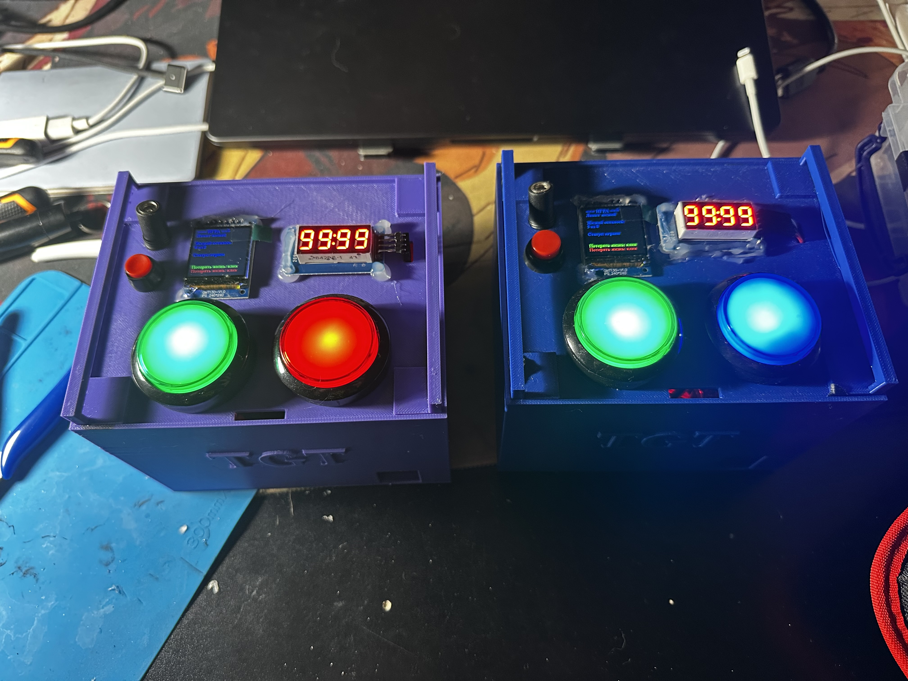
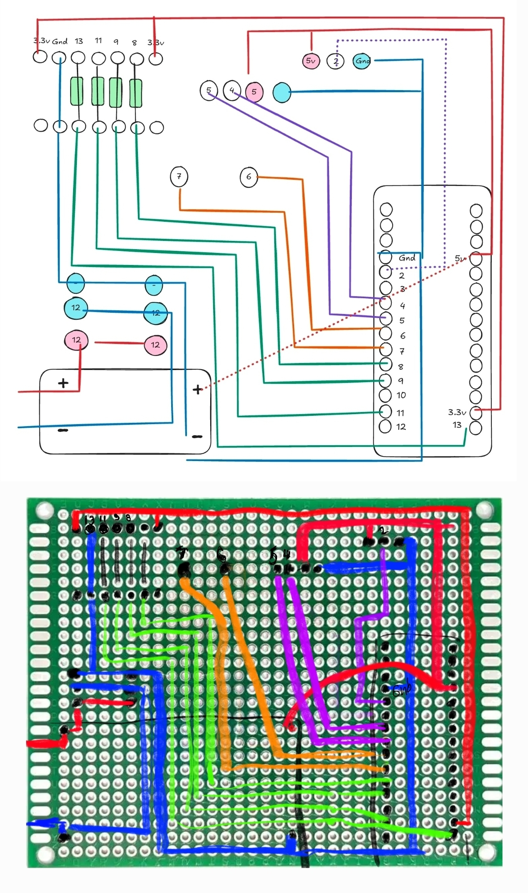

# TGT_GAME_DEVICE_PROJECT

## 📋 Оглавление
- [Версия](#версия)
- [Особенности](#особенности)
- [Аппаратная часть](#аппаратная-часть)
- [Фото устройства](#фото-устройства)
- [Схема подключеия](#схема-подключения)
- [3д модель коробки](#3д-модель)
- [Установка](#установка)

## Версия 

- ПО: 1.2.2
- 3д модель: 1.0.4 

## ✨ Особенности
- Экранные формы: 
    - Инструкция 
    - Выбор режима игры 
    - Настройка параметров игры 
    - Игра 
    - Конец игры 
- Доступные режимы: 
    - Респ по таймеру: таймер каждые N секунд пищит. N настраивается от 15 до 300 секунд
    - Мертвяк. Когда приходишь в мертвяк, нажимаешь кнопку. Добавляется время обратного отсчета. По окончанию отсчета выходишь из мертвяка. 
    - Лимит игроков. Ограничение на количество игроков в мертвяке. При достижении числа лимита игроков, они выходят из мертвяка.  
    - Лимит жизней. Ограничение жизней на всю игру.  
    - Скрытый счетчик. Во время игры после возвращения в мертвяк, нажимаешь кнопку. Счетчик смертей увеличивается. По итогу игры сравниваете у кого больше/меньше. 
- Особенности: 
    - Режимы двигаются поочередно "Выбор режима" -> "Параметры игры" -> "Игра" -> "Конец игры" -> "Выбор режима" -> ...
    - Краткое нажатие левой/правой кнопки соответственно уменьшение/увеличение
    - Длинное нажатие левой/правой кнопки подтверждение выбора
    - На самих экранных формах есть подсказка, что делает та или иная клавиша 

## 🔧 Аппаратная часть
| Компонент | Модель | Кол-во | Ссылка на озон|
|-----------|--------|--------|---------------|
| Arduino Nano | | 1 | https://www.ozon.ru/search/?deny_category_prediction=true&from_global=true&text=Электронный+модуль&product_id=3049800417|
| Семисегментный индикатор LED | TM1637  | 1 | https://www.ozon.ru/product/semisegmentnyy-indikator-led-tm1637-3591019257/ |
| Цветной IPS TFT дисплей   | ST7789 SPI, 240х240 1.3" | 1 | https://www.ozon.ru/product/tsvetnoy-ips-tft-displey-na-st7789-spi-240h240-1-3-933028499/ |
| GYMP Аккумуляторная батарейка,с батареей BMS литий защитная панель 12 В, 1800 мАч | ... | 1| https://www.ozon.ru/product/gymp-akkumulyatornaya-batareyka-s-batareey-bms-litiy-zashchitnaya-panel-12-v-1800-mach-1-sht-12-6v-2631193154/|
| Клеммы для проводов проходные 2-х контактные соединительные | ... | 1 | https://www.ozon.ru/product/klemmy-dlya-provodov-prohodnye-2-h-kontaktnye-soedinitelnye-20-sht-10-par-3011483244/ |
| Кнопка без фиксации с подсветкой 45мм, 12В | красная | 1 | https://www.ozon.ru/product/knopka-bez-fiksatsii-s-podsvetkoy-45mm-12v-krasnaya-3168510298/?oos_search=false |
| Кнопка без фиксации с подсветкой 45мм, 12В | синяя | 1 | https://www.ozon.ru/product/knopka-bez-fiksatsii-s-podsvetkoy-45mm-12v-sinyaya-10-sht-3168476883/?__rr=1&oos_search=false |
| Кнопка выключатель IP20 250В 3А 2 контакта 2 положения Вкл Выкл круглая красная duwi | ... | ... | https://www.ozon.ru/product/knopka-vyklyuchatel-ip20-250v-3a-2-kontakta-2-polozheniya-vkl-vykl-kruglaya-krasnaya-duwi-712157275/ |
| Зуммер активный | ... | 1 | https://www.ozon.ru/product/modul-zvukovogo-izluchatelya-zummer-933031781/?at=vQtrgp532IqJgqWRt0V1M70i7jKZzKF1gjDqBfM03gvL |
| Макетная плата  | 70x90 | 1 | https://www.ozon.ru/search/?deny_category_prediction=true&from_global=true&text=Плата+разработчика&product_id=640352994 |
| Понижатель напряжения | ... | 1 | https://www.ozon.ru/product/ponizhayushchiy-reguliruemyy-preobrazovatel-vhod-3-2-v-40-v-vyhod-1-25-35-v-dc-dc-lm2596s-3-sht-1120554319/ |
| 120 шт/Провода-перемычки Dupont 20 см | ... | ... | https://www.ozon.ru/product/120-sht-provoda-peremychki-dupont-20-sm-3-vida-po-40-sht-mama-mama-papa-papa-papa-mama-dlya-arduino-1534070622/|
| Разьем питания DC мама-папа комплект | ... | ... | https://www.ozon.ru/search/?deny_category_prediction=true&from_global=true&text=Коннектор&product_id=1322640601 |
| Резистор 1 КОМ 0,25ВТ 100 шт, 120R MF 1/4W 1% выводной | ... | 4 | https://www.ozon.ru/product/rezistor-1-kom-0-25vt-100-sht-120r-mf-1-4w-1-vyvodnoy-2056289747/ |
| Разъем на плату 40 Pin, шаг 2.54мм | ... | ... | https://www.ozon.ru/product/razem-na-platu-40-pin-shag-2-54mm-shtyrevoy-odnoryadnyy-shteker-shteker-komplekt-5sht-1450874064/ |
| Набор силиконовых многожильных проводов 22AWG. Луженая медь. 5 цветов по 10 метров. | ... | ... | https://www.ozon.ru/product/nabor-silikonovyh-mnogozhilnyh-provodov-22awg-luzhenaya-med-5-tsvetov-po-10-metrov-1705169852/ |
| ... | ... | ... | ... |

## 📸 Фото устройства

## 🔌 Схема подключения
| Компонент | Ардуино пин | Между | Модуль | 
|-----------|-------------|-------|--------|
| Дисплей TFT | GND | ... | GND |
| Дисплей TFT | 3.3v | ... | VCC |
| Дисплей TFT | D13 | 1 KOM | SCK |
| Дисплей TFT | D11 | 1 KOM | SDA |
| Дисплей TFT | D9 | 1 KOM | RES |
| Дисплей TFT | D8 | 1 KOM | DC |
| Дисплей TFT | 3.3v | ... | 3.3v |
| OLED циферблат | D5 | ... | CLK |
| OLED циферблат | D4 | ... | DIO |
| OLED циферблат | GND | ... | GND |
| OLED циферблат | 5v | ... | VCC |
| Зуммер | 5v | ... | 5V |
| Зуммер | D2 | ... | I/O |
| Зуммер | GND | ... | GND |
| Кнопка левая | D7 | ... | ... |
| Кнопка левая | GND | ... | ... |
| Кнопка левая | 12V+ | ... | ... |
| Кнопка левая | 12V- | ... | ... |
| Кнопка правая | D7 | ... | ... |
| Кнопка правая | GND | ... | ... |
| Кнопка правая | 12V+ | ... | ... |
| Кнопка правая | 12V- | ... | ... |
| ... | ... | ... | ... |

## 📥 3д_модель

- [Корпус](docs/3d/1.0.4_corpus.stl)
- [Крышка](docs/3d/1.0.4_up.stl)

## Установка

- Осуществить пайку и сборку 
- Воткнуть в ардуинку провод 
- Установить прошивку 
- Пользоваться